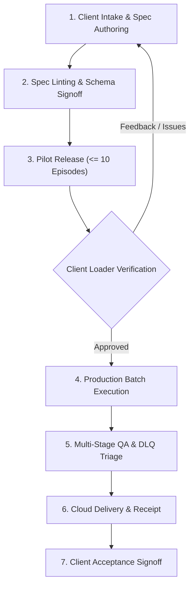

# EpisodeForge: Robotics Data Delivery Standard & Operating Procedure

> **Author:** Strategic Projects Lead (Robotics Data Platform)  
> **Status:** Active / Production Standard  
> **Version:** 1.0.0  
> **Applicability:** All customer robotic data deliveries, ingest pipelines, and schema transformation jobs.

---

## 1. Purpose & Core Principles

This document defines the formal Standard Operating Procedure (SOP) governing the end-to-end lifecycle of robotic demonstration datasets delivered to external ML research and engineering clients. 

At robotics data companies, delivering training data requires absolute accountability for quality, cryptographic integrity, and compliance with strict client schemas. We enforce four operational principles:

1. **Zero Silent Mutations:** Every dataset release is content-addressed, SHA-256 fingerprinted, and immutable. No data is modified in-place.
2. **Validate with Client Toolchains:** No dataset is considered delivered until verified using the client's official downstream loader (`lerobot`, `tensorflow_datasets`, `robomimic`).
3. **Deterministic & Auditable:** Same inputs + same specification version = identical output payload and content hash.
4. **Transparent Economics:** Operational throughput, compute core-hours, cloud egress, and unit costs are measured and tracked per delivery.

---

## 2. End-to-End Delivery Lifecycle



---

### Stage 1: Requirements Intake & Specification
Before any data is collected or transformed, the Strategic Projects Lead and Client Partner must complete a **Robotics Data Specification Sheet**:
- **Format Target:** `lerobot` (v3.0), `rlds` (TFDS), `robomimic_hdf5`, or `webdataset`.
- **Sensors & Cameras:** Name, mounting frame, resolution, color space, target FPS, encoding codec (AV1, H.264, JPEG).
- **Coordinate Conventions:** Base reference frame (`robot_base`, `world`), camera optical axis convention (`opencv` vs. `opengl`), rotation format (`rot6d`, `quat_xyzw`, `quat_wxyz`, `euler_xyz`).
- **Control & Action Space:** Control mode (`joint_pos`, `ee_delta_pose`), units (`m`/`mm`, `rad`/`deg`), gripper mapping (`[-1.0, 1.0]`, `[0.0, 1.0]`).
- **Timing & Alignment:** Nominal sampling frequency, maximum allowable inter-stream timestamp jitter (default $\le 2.0\text{ ms}$).

The intake form is translated into a machine-readable `ClientSpec` YAML file under `configs/clients/` and linted:
```bash
forge spec lint configs/clients/client_name.v1.yaml
```

---

### Stage 2: Pilot Release & Loader Validation
1. A small pilot batch of **10 representative episodes** is generated and transformed.
2. The pilot package is validated locally with the isolated official loader:
   ```bash
   forge validate-out data/releases/<client>/<dataset>_v1.0-pilot --spec configs/clients/<client>.v1.yaml
   ```
3. The pilot package is delivered to the client for validation within their specific training loop.
4. Any necessary convention adjustments are merged into the specification before scaling up.

---

### Stage 3: Production Execution & Quality Gates
During production runs, EpisodeForge enforces strict acceptance gates:

| Quality Gate | Standard Threshold | Failure Action |
| :--- | :--- | :--- |
| **Kinematic Bounds** | 100% within Franka Panda physical joint position and velocity limits | Quarantine episode to DLQ |
| **NaN / Inf Detection** | Zero NaN or Inf values in states, velocities, or actions | Immediate quarantine |
| **Timestamp Jitter** | $|t_{k} - t_{k-1} - \Delta t_{\text{target}}| \le 2.0\text{ ms}$ | Flag in QA report; resample |
| **Visual Integrity** | Zero corrupted frames, zero static black-frame dropouts | Reject camera stream |
| **Official Loader Check**| 100% pass rate loading transformed dataset | Abort delivery pipeline |

Any episode failing validation is automatically routed to `data/rejected/` with a forensic JSON audit manifest.

---

### Stage 4: Cloud Delivery, Manifests & Receipts
Releases are uploaded to S3 or MinIO object storage:
```bash
forge deliver data/releases/<client>/<release_id> --spec <spec.yaml>
```
Every delivery must include:
1. `delivery_manifest.json`: List of all payload files, sizes, and individual SHA-256 hashes, signed with a master release checksum.
2. `delivery_receipt.json`: Cloud transfer receipt including S3 destination URI, timestamp, and verification status.
3. `delivery_report.md`: Complete summary report for the client engineering team.

---

### Stage 5: Change Request (CR) Protocol
When a client requests mid-project modifications (e.g. changing camera resolution from $256\times 256$ to $224\times 224$ or switching from Euler angles to `rot6d`):
1. Create a versioned specification: `client_spec.v2.yaml`.
2. Compute the semantic diff and impact assessment:
   ```bash
   forge spec diff configs/clients/client_a.v1.yaml configs/clients/client_a.v2.yaml
   ```
3. EpisodeForge's content-addressable cache reprocesses **only the invalidated pipeline stages**, reusing cached upstream ingests and transforms.
4. Publish a semantic update (e.g. `v2.0`).

---

### Stage 6: Data Recall & Remediation Protocol
In the event that previously delivered episodes are found to contain subtle defects (e.g. improper task labels, uncalibrated camera extrinsics):
1. The Strategic Projects Lead issues a formal recall command:
   ```bash
   forge recall \
     --release-dir data/releases/<client>/<release_name> \
     --episodes ep_000004,ep_000009 \
     --reason "Operator defect: grasp contact slippage during terminal settle" \
     --patch-version v1.0.1
   ```
2. The recall engine:
   - Removes the defective episodes.
   - Re-indexes metadata, split files, and parquet tables.
   - Computes fresh SHA-256 manifests.
   - Publishes an immutable patch release (`v1.0.1`) alongside a signed `recall_notice.json`.
3. Client stakeholders receive automated notification with the updated download path and changelog.

---

## 3. SLA & Quality Standards

- **Deliverable Freshness:** Production runs process at $\ge 3,600\text{ episodes/hour}$.
- **Loader Compatibility:** 100% official loader pass rate.
- **Data Retention:** Raw recordings and quarantined DLQ artifacts are retained for 90 days minimum. Lineage metadata in DuckDB is retained indefinitely.

