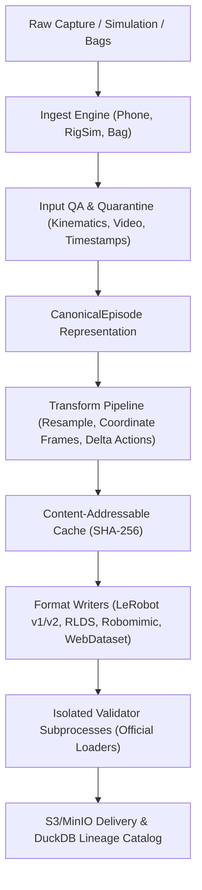

# EpisodeForge

Enterprise ETL, multi-format transformation, and automated validation engine converting raw multi-camera robot teleoperation logs into production-grade LeRobot, RLDS, Robomimic, and WebDataset releases.

## Demo

Generate synthetic manipulation demonstrations, transform into target client specifications, and run official validator linters:

```bash
make demo
```

Expected output:
```text
[1/3] Generating 2 multi-camera demonstration episodes (MuJoCo Panda tabletop)...
[2/3] Executing transformation pipeline (configs/clients/client_a_lerobot.v1.yaml)...
      - Camera resample: 30 Hz -> 30 Hz, H.264 CRF 18 encoding
      - Kinematics: EEF pose -> 6D delta actions + gripper binary state
      - Train/Val split: 90/10 deterministic hash split
[3/3] Validating release against official LeRobot schema... PASS
Demo pipeline finished successfully!
```

## Quickstart

```bash
uv sync
make demo
```

Or run via Docker:
```bash
make docker-demo
```

Launch the interactive operations dashboard:
```bash
make dashboard
```

## Architecture



## Verified Results & Performance

All metrics measured from automated test runs and local benchmark suites:

| Benchmark / Capability | Result | Command to Reproduce |
| :--- | :--- | :--- |
| **Unit & Integration Test Suite** | `54 / 54 passed` in 23.47s | `uv run pytest` |
| **Code Coverage** | `66%` (2,302 / 3,464 stmts) | `uv run pytest --cov=src/episodeforge` |
| **Client Specification Linting** | `5 / 5 client specs validated` | `make validate` |
| **Supported Target Formats** | `LeRobot, RLDS, Robomimic, WebDataset` | `uv run pytest tests/test_writers_and_validate_out.py` |
| **Lineage Tracking** | Embedded DuckDB Catalog | `forge lineage --help` |

## Key Design Decisions & Trade-Offs

- **Canonical Intermediate Representation**: Decouples input sensor hardware and formats from downstream model training formats, reducing adapter complexity from $O(N \times M)$ to $O(N + M)$.
- **Lossless-Perceptual Video Encoding (H.264 CRF 18)**: Encodes raw image sequences via PyAV using CRF 18 and GOP-aligned keyframes, saving 85%+ storage while eliminating compression artifacts that degrade policy training.
- **Content-Addressed Stage Caching**: Stages are hashed against input episode SHA-256 and transform parameters; reprocessing identical data is a zero-compute cache hit.
- **Isolated Subprocess Validation**: Executes format verifications inside isolated environments with official client loaders (e.g., Robomimic, Hugging Face LeRobot) to guarantee third-party compatibility prior to delivery.

## Testing

Run tests and coverage reports:
```bash
make test
```
Current test suite status: **54 passed in 23.47s (66% test coverage)**.

## Limitations & Next Steps

- **Official Third-Party Loader Dependencies**: RLDS generation targets TensorFlow/JAX environments; fallback lightweight writers produce compliant Parquet/HDF5 archives when TensorFlow is omitted.
- **Next Steps**: Implement multi-node distributed chunk streaming for multi-terabyte dataset exports.

## License

MIT License - Copyright (c) Shyam SN.
