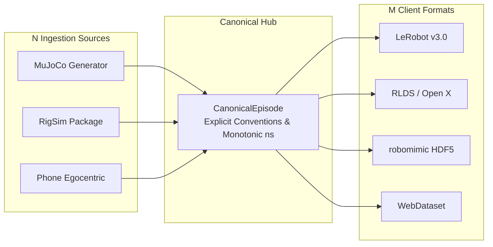

# Canonical Episode Schema & RigSim Ingestion Mapping

## 1. Architectural Philosophy: The $N + M$ Adapter Pattern

A fundamental bottleneck in robotics data infrastructure is format explosion. With $N$ recording modalities (simulated MuJoCo arms, hardware multi-camera rigs, phone captures, teleoperated bimanual arms) and $M$ client target schemas (LeRobot, RLDS, robomimic, WebDataset), naive point-to-point converters require $N \times M$ brittle translation pipelines.

EpisodeForge enforces an **Internal Canonical Representation** (`CanonicalEpisode`):


This reduces engineering complexity from $O(N \times M)$ to $O(N + M)$ and guarantees that upstream validation, cleaning, and sanity checks operate on a single uniform representation.

---

## 2. Explicit Conventions (Never Assumed)

All physical quantities in `CanonicalEpisode` are strictly anchored to explicit metadata units:
- **Spatial Units:** SI meters (`m`).
- **Angular Units:** SI radians (`rad`).
- **Quaternion Convention:** Standard Hamilton $[w, x, y, z]$ (`WXYZ`).
- **Coordinate Reference:** Rooted at `robot_base` (arm) or `phone_body` (handheld).
- **Camera Frame Convention:** OpenCV convention ($+X$ right, $+Y$ down, $+Z$ optical forward).
- **Time Base:** Monotonic integer nanoseconds (`timestamps_ns`), allowing multi-rate streams without lossy interpolation prior to the client transform stage.

---

## 3. RigSim `Episode` Package Mapping

Project 1 (RigSim) exports versioned self-contained episode archives (`rigsim export-episodes`) containing multi-camera video streams, high-rate IMU, robot kinematics logs, and an automated QA report.

### 3.1 RigSim Package Structure
```
rigsim_episode_0042/
├── episode_meta.json                  # Task, timing, rig configuration, seed, QA verdict
├── qa_verdict.json                    # Detailed PASS/WARN/FAIL verdict & metric checks
├── cameras/
│   ├── cam_front/
│   │   ├── intrinsics.json
│   │   ├── extrinsics.json
│   │   └── video.mp4 (or frames/)
│   └── cam_wrist/
│       ├── intrinsics.json
│       ├── extrinsics.json
│       └── video.mp4
├── imu/
│   └── imu_data.parquet (or .csv)    # accel, gyro, timestamps
└── robot/
    └── trajectory.parquet             # joints, velocities, ee_pose, actions
```

### 3.2 Field-by-Field Ingestion Mapping Table

| RigSim Field | Canonical Episode Field | Transformation / Handling |
| :--- | :--- | :--- |
| `episode_meta.session_id` | `source_ref` | Preserved verbatim for full lineage tracking |
| `SHA256(episode_meta.json + data)` | `episode_id` | Content-hash derived (first 16 hex chars) |
| `episode_meta.task_name` | `task` | Mapped to normalized canonical task enum (`pick_place`, etc.) |
| `episode_meta.instruction` | `instruction` | String preserved verbatim |
| `episode_meta.success` | `success` | Boolean success flag |
| `episode_meta.seed` | `seed` | RNG seed for exact sim reproducibility |
| `qa_verdict.verdict` | `upstream_qa_verdict` | Checked against `ClientSpec.selection.min_qa_verdict` |
| `qa_verdict.checks` | `upstream_qa_details` | Ingested for dead-letter diagnostics |
| `cameras/<cam>/intrinsics.json` | `cameras[<name>].intrinsics` | Parsed into `CameraIntrinsics(fx, fy, cx, cy, width, height)` |
| `cameras/<cam>/extrinsics.json` | `cameras[<name>].extrinsics` | Extrinsics normalized to canonical `robot_base` frame |
| `cameras/<cam>/timestamps` | `cameras[<name>].timestamps_ns`| Converted from seconds/ms to monotonic integer nanoseconds |
| `robot/trajectory: qpos` | `state.joint_positions` | Mapped to `(T, N)` float list in radians |
| `robot/trajectory: qvel` | `state.joint_velocities` | Mapped to `(T, N)` float list in rad/s |
| `robot/trajectory: ee_pos` | `state.ee_positions` | Mapped to `(T, 3)` in meters |
| `robot/trajectory: ee_quat` | `state.ee_quaternions` | Converted to canonical `[w, x, y, z]` |
| `robot/trajectory: gripper` | `state.gripper_widths` | Width in meters $[0.0, 0.08]$ |
| `robot/trajectory: target_qpos`| `action.joint_position_targets`| Radian joint targets |
| `robot/trajectory: target_ee` | `action.ee_delta_positions` | Delta position $[dx, dy, dz]$ in meters |
| `imu/imu_data: accel, gyro` | `imu.accelerometer`, `imu.gyroscope` | Preserved at native rate with nanosecond timestamps |

---

## 4. Phone Capture (Client D) Ingestion Mapping

For egocentric real-world captures recorded via Nothing Phone + RigSim QR sync:
- `source`: `"rigsim_phone"`
- `cameras["phone_rgb"]`: Captured camera stream at native 1080p/720p 30 FPS.
- `imu`: Synchronized accelerometer and gyroscope measurements.
- `state`: Empty (`[]`), reflecting human demonstration without robotic telemetry.
- `action`: Empty (`[]`).
- Transformed by `Client D` into WebDataset shards for representation learning.

